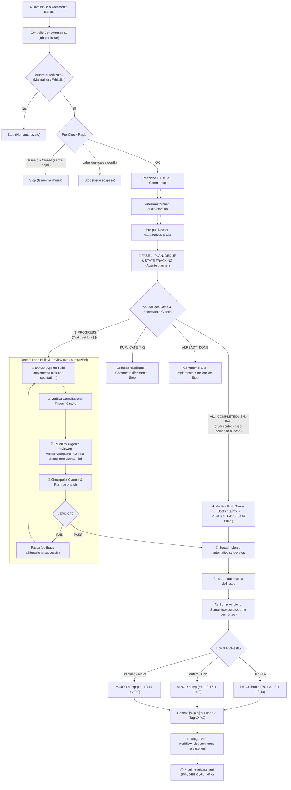

# 🤖 CI/CD & Autonomous Development Workflows

Questa cartella contiene i workflow GitHub Actions per **NavigatorOSM**:
1. **`opencode.yml`**: Ciclo di sviluppo autonomo multi-agente con triage, dedup, planning, build e review (Theos Docker iOS 9.3.5 / armv7), auto-merge su `develop`, bump semantico e trigger del rilascio.
2. **`release.yml`**: Compilazione distribuibile completa (IPA iOS, pacchetto DEB Cydia, APK Android GPSTether) e pubblicazione su GitHub Releases e Cydia APT Repository (GitHub Pages).

---

## 🗺️ Architettura Generale del Ciclo Autonomo



---

## 🛡️ Dettaglio Fasi e Meccanismi di Sicurezza

### 1. Pre-Check Rapidi & Concurrency
- **Concurrency Lock**: Tramite `concurrency: group: opencode-${{ issue.number }}`, commenti multipli o simultanei sulla stessa issue non creano conflitti git: le esecuzioni vengono accodate in modo ordinato.
- **Fast Exit**: Se un'issue è già etichettata `duplicate`, `invalid` o `wontfix`, o se è già `closed` (senza istruzione di riapertura), il workflow si arresta immediatamente senza sprecare minuti di runner.

### 2. Fase 1: Plan, Deduplicazione & Macchina a Stati (Separata da Build)
L'agente [`.opencode/agents/planner.md`](file:///home/nicola/Devel/retrofit/iOS/NavigatoreOSM/.opencode/agents/planner.md) agisce come macchina a stati persistente:
- **Salvataggio in `issue_plans/`**: I piani vengono tracciati e versionati in `issue_plans/<plan_key>.md`.
- **Riconoscimento dello stato e ripresa (Resume)**:
  - Se il piano esiste già (es. da una run precedente interrotta), il planner ispeziona il codice effettivo e aggiorna le spunte: `- [x]` per i criteri già soddisfatti, `- [ ]` per quelli mancanti.
  - Se tutti i criteri sono già soddisfatti (`- [x]`) o se l'utente richiede esplicitamente la pubblicazione/rilascio (`/oc procedi con la pubblicazione`):
    emette `PLAN_STATUS: ALL_COMPLETED`, valida la compilazione Theos (`VERDICT: PASS`) e **salta completamente la Fase 2 di Build**, procedendo direttamente al merge e release!
  - Se il flusso era stato interrotto, riprende l'esecuzione solo dai task non ancora completati (`- [ ]`).
- **Deduplicazione & Already Done**:
  - `ALREADY_DONE`: La feature è già presente nel branch base.
  - `DUPLICATE`: La richiesta è un duplicato di un'altra issue.

### 3. Fase 2: Build & Review Loop
Viene eseguita solo se `PLAN_STATUS == 'IN_PROGRESS'`:
- **Build**: Implementa unicamente i task contrassegnati con `- [ ]`.
- **Review**: Verifica compilazione Theos (iOS armv7) e Android (GPSTether), aggiorna progressivamente le spunte `- [x]` nel file del piano ed emette `VERDICT: PASS` o `FAIL`.
- **Checkpoint & Persistenza**: Ad ogni iterazione, il codice e il piano aggiornato vengono committati e pushati sul branch remoto. In caso di timeout o cancellazione accidentale, lo stato è preservato.

### 4. Build & Review Loop
- **Build**: Implementa le modifiche sui file di codice (Objective-C per iOS o Java/Kotlin per il companion Android `android/`).
- **Verifica Compilazione**: Lancia la compilazione Theos nativa a 32-bit:
  ```bash
  docker run --rm -v "$PWD:/project" -w /project cauan/theos make all DEBUG=0 messages=no
  ```
  *(e `./gradlew test assembleDebug` se viene modificata la cartella `android/`)*.
- **Review**: L'agente [`.opencode/agents/reviewer.md`](file:///home/nicola/Devel/retrofit/iOS/NavigatoreOSM/.opencode/agents/reviewer.md) verifica se ogni criterio è soddisfatto e se il binario compila pulito. Termina con `VERDICT: PASS` o `VERDICT: FAIL`.

### 5. Auto-Merge & Chiusura Issue
Se la review restituisce `VERDICT: PASS`:
1. Sincronizza ed esegue l'auto-merge via squash sul branch `develop`.
2. Chiude l'issue con `state_reason: completed`.

### 6. Bump Semantico & Trigger Release
Uno script unificato ([`scripts/bump-version.py`](file:///home/nicola/Devel/retrofit/iOS/NavigatoreOSM/scripts/bump-version.py)) aggiorna atomicamente:
- `control` (`Version: X.Y.Z`)
- `NavigatoreOSM/Info.plist` (`CFBundleShortVersionString` e `CFBundleVersion`)
- `android/app/build.gradle` (`versionName` e `versionCode + 1`)

Viene quindi generato e pushato il tag git `vX.Y.Z`, e tramite l'API di GitHub viene scatenato il workflow [`release.yml`](file:///home/nicola/Devel/retrofit/iOS/NavigatoreOSM/.github/workflows/release.yml) che compila IPA, DEB e APK rilasciandoli su GitHub Releases e sulla repo Cydia ufficiale.

---

## ⌨️ Come Attivare OpenCode

### 1. All'apertura di una nuova Issue
Usa i template interattivi:
- **Feature Request** (`.github/ISSUE_TEMPLATE/feature_request.yml`)
- **Bug Report** (`.github/ISSUE_TEMPLATE/bug_report.yml`)

Il comando precompilato in fondo avvia la action in automatico.

### 2. Tramite Commento
In qualsiasi Issue o Pull Request aperta:
```text
/oc correggi l'anomalia nel ricalcolo del percorso OSRM
```

Opzioni avanzate disponibili:
- **Modello specifico**:
  ```text
  /oc --model opencode/claude-3-7-sonnet ottimizza il consumo di memoria
  ```
- **Forzare il tipo di incremento semantico**:
  ```text
  /oc --bump minor aggiungi il selettore del tipo di carburante preferito
  ```
